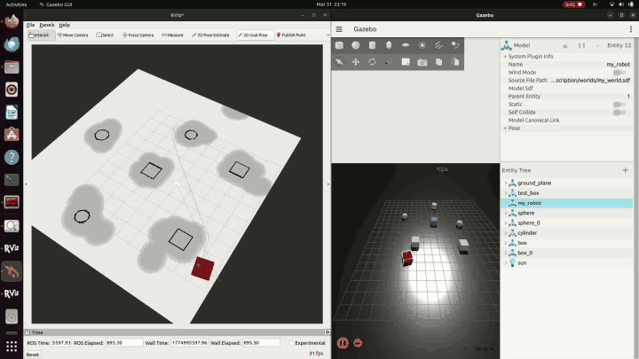
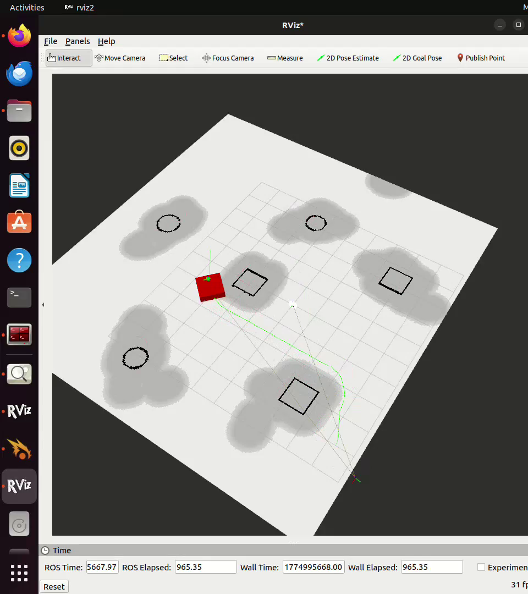
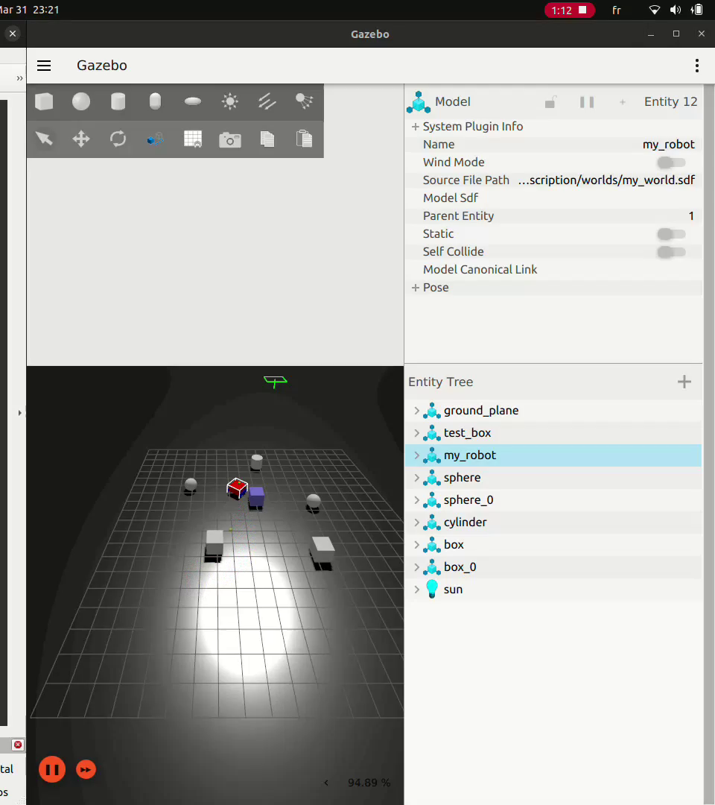
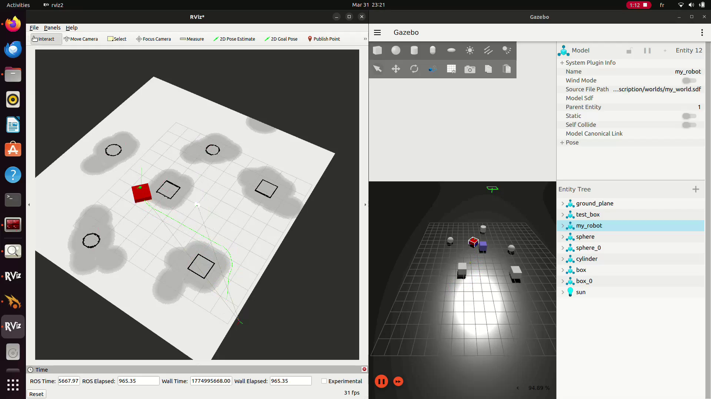
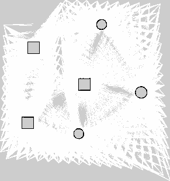
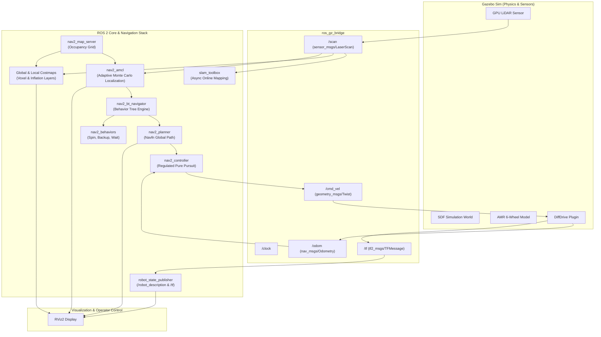

# Autonomous Mobile Robot (AMR): SLAM & Nav2 Simulation

[](https://docs.ros.org/)
[](https://gazebosim.org/)
[](https://navigation.ros.org/)
[](https://github.com/SteveMacenski/slam_toolbox)
[]()
[](LICENSE)

An end-to-end, production-grade **Autonomous Mobile Robot (AMR)** simulation package built with **ROS 2**, **Gazebo Sim**, **SLAM Toolbox**, and the **Nav2** stack.

The robot features a robust **6-wheel differential-drive chassis** designed for heavy industrial and warehouse payload transport, equipped with a 360° LiDAR sensor, real-time SLAM mapping, AMCL probabilistic localization, voxel/inflation costmaps, and Regulated Pure Pursuit path tracking.

---

## 🎬 Demonstration

### Autonomous Navigation in Action (Accelerated 4x)


> *Watch full high-definition recording: [`docs/media/simulation_demo_accelerated.mp4`](docs/media/simulation_demo_accelerated.mp4)*

---

## 📸 Simulation & Mapping Gallery

| Gazebo 3D Simulation Environment | RViz2 Navigation & Costmaps |
| :---: | :---: |
|  |  |
| *6-Wheel AMR spawned in custom obstacle environment* | *Global/Local costmaps, AMCL pose, and planned path* |

| Synchronized Gazebo + RViz2 Execution | Generated 2D SLAM Occupancy Grid Map |
| :---: | :---: |
|  |  |
| *Dual-screen real-time synchronization* | *High-resolution occupancy grid produced via SLAM Toolbox* |

---

## 🌟 Key Highlights & Features

- **Robust 6-Wheel Differential Drive**: Custom URDF kinematics model with 3 wheels per side providing high ground contact, traction, and load distribution.
- **LiDAR Sensor Integration**: GPU-accelerated 360° 2D LiDAR (`/scan`) bridged seamlessly from Gazebo Sim to ROS 2 standard sensor messages.
- **Real-Time SLAM Mapping**: Online asynchronous LiDAR SLAM via `slam_toolbox` leveraging the Ceres nonlinear optimization solver for graph-based loop closures.
- **Nav2 Autonomous Navigation**: Complete integration with Navigation2 lifecycle managers:
  - **Global Planner**: `NavfnPlanner` producing Dijkstra / A* optimal global collision-free paths.
  - **Local Controller**: `RegulatedPurePursuitController` with adaptive velocity scaling, lookahead distance scaling, and collision carrot checking.
  - **Costmaps**: 2D static, obstacle, and inflation layers with custom robot polygonal footprint ($1.0\,\text{m} \times 1.1\,\text{m}$).
  - **Behavior Trees**: Custom replanning pipeline sequence (`navigate_to_pose.xml`).
  - **Recovery Behaviors**: Spin, back-up, and wait recovery actions.
- **Fully Automated Launch Pipelines**: Single-command startup for both mapping mode and autonomous navigation mode with timed lifecycle transitions.

---

## 🏗️ System Architecture



---

## 🤖 Robot Specifications

| Specification | Value | Description |
| :--- | :--- | :--- |
| **Chassis Dimensions** | $1.0\,\text{m} \times 1.0\,\text{m} \times 0.5\,\text{m}$ | Compact industrial box frame |
| **Total Mass** | $35.1\,\text{kg}$ | $30\,\text{kg}$ chassis + $6 \times 0.8\,\text{kg}$ wheels + sensor |
| **Wheel Diameter** | $0.36\,\text{m}$ (radius $0.18\,\text{m}$) | High ground clearance |
| **Wheel Track (Separation)** | $1.10\,\text{m}$ | Enhanced turning stability |
| **Drive Configuration** | 6-Wheel Differential Drive | 3 drive joints per side linked via DiffDrive plugin |
| **LiDAR Sensor** | 360° Field of View | 720 samples, 10 Hz rate, $0.08\,\text{m} - 10.0\,\text{m}$ range |
| **Max Linear Velocity** | $0.5\,\text{m/s}$ | Configurable via velocity smoother |
| **Max Angular Velocity** | $1.0\,\text{rad/s}$ | Configurable via velocity smoother |

---

## 📁 Repository Structure

```
.
├── docs/
│   └── media/
│       ├── simulation_demo.gif              # Animated navigation showcase for README
│       ├── simulation_demo_accelerated.mp4  # 4x accelerated 1080p demonstration video
│       ├── simulation_split_view.png        # Synchronized Gazebo + RViz view
│       ├── gazebo_view.png                  # Gazebo simulation screenshot
│       ├── rviz_view.png                    # RViz2 localization & costmap screenshot
│       └── slam_map.png                     # Generated SLAM occupancy grid map
├── myrobot_description/
│   ├── config/
│   │   ├── nav2_params.yaml                 # Nav2 stack configuration (AMCL, Costmaps, RPP)
│   │   ├── navigate_to_pose.xml             # Behavior tree replanning XML definition
│   │   ├── slam.rviz                        # RViz2 configuration with displays & toolbars
│   │   └── slam_toolbox_params.yaml         # SLAM Toolbox online mapping parameters
│   ├── launch/
│   │   ├── mapping.launch.py                # Launch Gazebo + SLAM Toolbox for map building
│   │   └── sim.launch.py                    # Launch Gazebo + AMCL + Nav2 stack + RViz2
│   ├── maps/
│   │   ├── my_map.pgm                       # Saved 2D occupancy grid raster
│   │   └── my_map.yaml                      # Map metadata (resolution, origin, thresholds)
│   ├── myrobot_description/
│   │   └── __init__.py                      # Python package marker
│   ├── resource/
│   │   └── myrobot_description             # Ament index package marker
│   ├── test/
│   │   ├── test_copyright.py                # Copyright linter test
│   │   ├── test_flake8.py                   # Flake8 style compliance test
│   │   └── test_pep257.py                   # Docstring PEP257 test
│   ├── urdf/
│   │   └── robot.urdf                       # 6-wheel AMR URDF with Gazebo friction & plugins
│   ├── worlds/
│   │   ├── my_world.sdf                     # Main simulation environment with obstacles
│   │   └── world1.sdf                       # Alternative test world
│   ├── package.xml                          # ROS 2 package dependencies & metadata
│   ├── setup.cfg                            # Package executable script installation config
│   └── setup.py                             # Ament Python setup script
├── .gitignore                               # Git ignore rules for ROS 2 & build artifacts
├── LICENSE                                  # Apache 2.0 open-source license
└── README.md                                # Project documentation
```

---

## ⚡ Quickstart Guide

### 1. Prerequisites
Ensure you have an active ROS 2 installation (Humble or Jazzy) with the required dependencies:

```bash
# Update package lists
sudo apt update

# Install ROS 2 simulation and navigation packages
sudo apt install -y \
  ros-$ROS_DISTRO-ros-gz \
  ros-$ROS_DISTRO-ros-gz-sim \
  ros-$ROS_DISTRO-ros-gz-bridge \
  ros-$ROS_DISTRO-navigation2 \
  ros-$ROS_DISTRO-nav2-bringup \
  ros-$ROS_DISTRO-slam-toolbox \
  ros-$ROS_DISTRO-robot-state-publisher \
  ros-$ROS_DISTRO-rviz2
```

### 2. Workspace Setup & Build

```bash
# Create a ROS 2 workspace
mkdir -p ~/amr_ws/src
cd ~/amr_ws/src

# Clone this repository
git clone https://github.com/chaabanejasser01/amr-slam-nav2.git

# Build the workspace
cd ~/amr_ws
colcon build --symlink-install

# Source the overlay
source install/setup.bash
```

### 3. Run Quality Linters & Unit Tests

Verify code quality and style compliance:
```bash
colcon test --packages-select myrobot_description
colcon test-result --verbose
```

---

## 🚀 Execution & Usage

### Option A: Online SLAM Mapping (Generate a New Map)
To map an unknown environment with the 6-wheel robot using `slam_toolbox`:

```bash
# Launch Gazebo simulation with SLAM Toolbox
ros2 launch myrobot_description mapping.launch.py
```

In a separate terminal, teleoperate the robot to explore the environment:
```bash
ros2 run teleop_twist_keyboard teleop_twist_keyboard
```

When mapping is complete, save the map:
```bash
ros2 run nav2_map_server map_saver_cli -f ~/amr_ws/src/amr-slam-nav2/myrobot_description/maps/my_map
```

---

### Option B: Autonomous Navigation (Nav2 + AMCL)
To run autonomous point-to-point navigation using the saved map:

```bash
# Launch Gazebo, AMCL localization, Nav2 stack, and RViz2
ros2 launch myrobot_description sim.launch.py
```

1. **RViz2** will automatically open with the pre-configured display configuration.
2. The robot will spawn in Gazebo, and the localization lifecycle will automatically activate.
3. In **RViz2**, click the **2D Goal Pose** tool at the top bar and click/drag anywhere on the map to set a navigation target.
4. The global planner will generate a collision-free path, and the Regulated Pure Pursuit controller will drive the robot to the goal while dynamically avoiding obstacles.

---

## ⚙️ Navigation & Control Parameter Tuning

### Regulated Pure Pursuit Controller (`RPP`)
- **Lookahead Distance**: Set between $0.6\,\text{m}$ (min) and $1.5\,\text{m}$ (max) with velocity scaling enabled (`use_velocity_scaled_lookahead_dist: true`), ensuring agile cornering at low speeds and smooth stability at higher speeds.
- **Curvature Regulation**: Dynamically lowers linear speed when approaching tight turns to prevent wheel slippage on the 6-wheel differential chassis.
- **Collision Detection**: Lookahead carrot projection scans the costmap up to $1.0\,\text{s}$ ahead to stop or reroute before collision.

### AMCL Localization
- **Motion Model**: `DifferentialMotionModel` with tuned odometry noise alphas ($\alpha_1 = \dots = \alpha_5 = 0.2$).
- **Laser Model**: Likelihood field with dynamic beam skipping (`beam_skip_distance: 0.5`) to eliminate false matches from moving obstacles.
- **Particle Cloud**: Dynamic resampling between $500$ (minimum) and $2000$ (maximum) particles.

---

## 👤 Author

**Chaabene Jasser**
- GitHub: [@chaabanejasser01](https://github.com/chaabanejasser01)
- Email: [Jasser.chaabane@eniso.u-sousse.tn](mailto:Jasser.chaabane@eniso.u-sousse.tn)
- Focus: Robotics & Embedded Systems | ROS 2 | Autonomous Navigation | SLAM

---

## 📄 License

This project is licensed under the Apache License 2.0 - see the [LICENSE](LICENSE) file for details.
